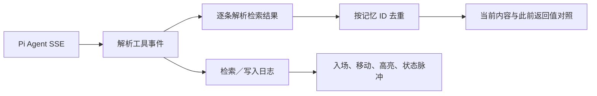

# 参考聊天站点 引导与记忆侧栏分析

参考页面：[参考聊天站点](https://memos-playground.openmem.net/cn/main/service/)。2026-10-31 使用 SuperDuck 在已登录 Chrome 中观察，并下载公开 Nuxt JavaScript、CSS 和机器人图片作静态分析。原始资源和 SHA-256 清单保存在任务的 `reference/` 目录，截图保存在 `artifacts/`，均不进入业务仓。

## 原站引导

`entry.C7JIk-bE.js` 的教程配置包含以下状态；每步有目标选择器、弹窗位置、尺寸、按钮条件和进入/离开钩子。进度通过原站的教程接口保存。

- 欢迎卡宽 445px，资料表单宽 700px，均限制最大视口宽度；机器人位于卡片左上方，主按钮为白色。
- 原站资料表单的 `beforeNext` 会更新资料并自动发起示例对话；后续步骤等待回答完成，部分按钮有 5 秒倒计时。
- 聚光配置支持多个高亮区域、箭头连接、元素交互和不同角的圆角；日志步骤定位 `#log-container`。
- 当前 Pi Agent 只有账号与项目绑定的固定会话。本实现采用欢迎卡、可选偏好表单、五步聚光指引；表单生成可检查的草稿，由用户发送。项目切换、输入、对话、日志和首句分别有明确指引。

## 记忆侧栏与动画

`chat.DYOR1CKt.js` 订阅 `latestLog`，保留至多 60 条日志。新事件排队，每 3 秒处理一条；事件的 `label`、`memcubeLogContent`、`metadata`、`fromMemoryType`、`toMemoryType` 分别决定日志标题、内容、详情及记忆层级迁移的呈现。

`chat.DiYP1UkF.css` 中的相关参数：

| 行为 | 原站实现 | 本次实现 |
| --- | --- | --- |
| 新日志入场与列表位置移动 | Vue TransitionGroup，0.6s，初始透明度 0、缩放 0.95 | Motion 位置布局与相同入场参数 |
| 新日志提示 | `newLogHighlight`，2s | 主题色高亮淡出，2s |
| 调度节点提示 | 1.5s 中心脉冲、扩散至 3.5 倍 | 进行中事件的节点脉冲与扩散 |
| 详情 | 单条记忆内容及 metadata | 逐条内容、标题、来源、相关性、展开及定位 |
| 内容变化 | 后端调度事件及对应条目 | 同一记忆 ID 在两次检索中返回不同内容时，展示此前内容 |

当前复刻的数据路径：

记忆库展示当前对话已检索到的记忆，不将它当成项目的完整库存。失败和未完成的结果不会加入记忆库。写入调用完成也不会被显示成“已提取 N 条新记忆”。

原站的内部层级迁移和异步提取完成事件不属于现有 Pi Agent SSE 契约；本次没有复制原站服务接口或构造这类事件。若后端以后提供这些事件，应将其接入同一个日志模型，再展示对应变更与迁移动画。

## 验证边界

构建、浏览器验收和记忆解析检查覆盖前端与本地 mock。真实模型调用、数据面异步提取和集群部署不在这次前端复刻验证中。首次指引、跳过和重放均不会调用模型。

## MemCube 日志样式复核

后续根据用户反馈重新操作真实 Chrome：发送一条不含隐私的菜谱问题，观察新增、更新、调度及写入日志，并打开实际记忆详情。原实现把完整卡片、页签、说明和底栏放进侧栏，改变了参考页的密度；现已改回摘要时间线。

| 项目 | 真实页面测量 | 当前实现 |
| --- | --- | --- |
| 1440×843 下侧栏 | x=1040、y=56、宽400、padding20 | 一致 |
| 首卡起点与宽度 | x=1087、y=119、宽333 | 一致 |
| 卡片 | padding8、圆角6、边线 #e3e4ff | 一致 |
| 标题与摘要 | 标题14px/20px；摘要12px/16px，单行截断 | 一致 |
| 节点 | 内圈6px、外圈12px；1px连接线 | 同尺寸，失败显示错误色 |
| 详情 | 512px 字段表弹窗，摘要旁展开 | 显示当前接口实际提供的字段；可定位对话 |
| 背景 | 顶部200px内嵌 WebP 及浅色渐变 | 原背景资产本地化；配套深色主题 |

侧栏不再有页签、说明行、计数条或底栏。已有去重记忆库通过标题旁的图标打开；内容变化以详情中的此前内容呈现。新调用入场0.6s，节点1.5s脉冲/扩散；打开详情或滚动日志后清除新事件标记。历史加载不标记为新事件。

相关公开资源为 `chat.DYOR1CKt.js`、`chat.DiYP1UkF.css`、`Detail.B-Gq_qRm.js`、`Detail.Co_ogIhE.css`；本轮 SHA-256 清单位于任务 `reference/memcube-asset-manifest.json`，未执行下载的 JavaScript。

当前工具事件没有可靠调用时间和原站内部调度字段，因此不编造时钟、调度或提取事件。日志沿用真实 Pi 工具事件及结果；参考页面只用于核对视觉与交互。
