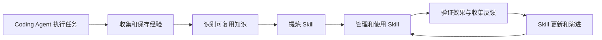

# P1a：Claude Code 适配、事件记录与隐藏评测隔离

日期：2026-11-08。依据：[冻结设计第 9 节](skill-extraction-design.md#9-claude-code-与控制面适配)、[开发计划](skill-prototype-development.md)、[P0b 验收底座](skill-prototype-p0b.md)。先明确本文件的范围与验收，再实施。

## 1 与最终闭环的关系

最终目标保持 issue 的完整闭环：

P1a 完成 A 的真实运行入口、B 的本地过程工件、E 的固定版本加载，以及 F 的结果回收和 P0 外部验收连接。P1b 才将合格来源工件写入 MemOS 并实际回读；P2 识别/提炼与 Skill Graph；P3 管理及人工发布；P4 对照效果；P5 更新与失效传播。人工编写的适配探针 Skill 只验证传输与执行机制，不能冒充从 Memory 提炼的成果或完整闭环。

## 2 本轮范围与技术选择

- 使用本机已安装 Claude Code CLI **2.1.296** 的 `-p --output-format stream-json`，不新增 Python Agent SDK。CLI 本身是官方提供的程序化入口；锁定 CLI 版本与可执行文件摘要，运行前后复核，不自动更新或使用 latest。
- 输入为注册 Case、精确 Skill revision（或无 Skill）、固定规则集合、内容摘要、允许工具、模型标识、预算与超时。独立运行目录保存任务副本；控制目录保存只读 Skill、设置与记录程序；可信侧保存事件、快照与 oracle。
- 配置白名单只借用用户既有认证/服务端点和选定模型，在内存中传入，不复制用户 hooks、插件、历史或其他 Skill。端点与凭据不写入仓库或可见任务，运行报告对敏感值脱敏。不改用户 HOME、现有 Claude 设置或已登录状态。
- 使用 `CLAUDE_CONFIG_DIR` 与显式设置来源、工具集合、MCP 配置固定运行上下文；不开 bare（本轮需要 hooks）。未知 alias 在调用模型前拒绝，不能接受 CLI 把未知命令退成普通 prompt 的行为。
- 首版隔离后端限定 **macOS sandbox-exec**，默认拒绝文件访问，只开放系统/CLI/Python 运行时、任务工作区和必要控制材料。隐藏任务资产、仓库、其他 Run、可信报告不可读写；Skill/设置/钩子只读。工具权限限制与沙箱共同作用，任何隔离能力缺失均拒绝启动，不回退到无隔离执行。该接口已被系统标为 deprecated；Linux/容器后端留作替代实现，不宣称跨平台已验收。
- 本轮只做本地实验授权的探针/候选使用，不实现 Release 服务、人工审批、Neo4j、数据库持久化、自动提炼或发布。依赖只允许输入中已固定且已验证的工件，不自动跟随 RELATED_TO 或 latest。

实现按“先失败测试 → 工件与事件 → OS 隔离 → 原生 CLI 运行与回收 → 实测报告”推进。分支 `codex/skill-prototype-p1a` 基于 `83244366`；功能与测试成组中文提交，不改写旧提交，不推送或合并。现有未跟踪 `bin/` 不动。

## 3 适配器最小契约

工件记录 `skill_id/revision/canonical_digest/rule_ids/requires`、导出器版本、唯一 runtime_alias、文件清单及 export_hash。导出是固定格式转换；冲突、路径逃逸、符号链接和内容漂移拒绝。每次执行前与回收后检查，运行中不切版。

RunContext 绑定 case/revision/split/lineage、run/attempt 和初始快照。模型不能改用途、版本或评分依据。实际模型由显式配置选择，保存请求及原生返回的标识；不能把代理报告的标识当成模型权重经过独立认证。

加载分为 prepared、discovered、native_expanded、observed_use。`system/init` 列表仅证明发现；`UserPromptExpansion` 证明该 alias 走原生展开路径，没有正文/hash。结合唯一 alias、封存工件、只读边界与锁版本的探针，才能给出本轮加载判定；缺事件或证据冲突保持 unknown/load_unverified。探针可在 Skill 正文中放置独有标记，观察其按指令使用，但不把复述标记视作正确修复或一般可靠性证明。

事件逐条带 collector sequence/event_id、run/attempt、来源类别、真实原生标识（缺失则为空）和完整性状态；区分 CLI 原生事件、工具动作与 Agent 规则声明。只记录公开行动、结果与简短判断，不采集私有推理。原始输出在内存中投影和脱敏后落盘，不能先把 thinking/凭据写成 JSONL 再清理。

规则记录只接受当前 revision 的规则 ID 与本次 Run 的事件引用。若使用 MCP 记录器，它仅证明声明被接收；实际动作须与原生工具事件及最终差异核对。没有观察证据的规则应用保持 unknown，不从最终成功反推全部规则已执行。

完成后停止本次进程及未决后台动作，核对控制工件，封存任务副本，调用 P0 独立验收；Agent 的 result success 不等于 task accepted。超时、断流、未配对工具事件和 hook 失败记 partial/capture_incomplete；采集错误不自动等于基础设施失败或可排除样本。适用性和严重违规的语义归因仍需任务证据与后续审阅。

## 4 验收标准

| 编号 | 通过条件 |
| --- | --- |
| C01 工件 | 精确 revision/hash/alias 固定，冲突、未知 alias、漂移与非法路径拒绝；无自动 latest |
| C02 原生加载 | 真正 Claude CLI 2.1.296 运行能观察发现与原生展开，并取得固定正文探针的使用证据；不是模拟输出 |
| C03 上下文 | 独立配置来源与固定工具集合；无用户插件/额外 Skill 或父级项目经验混入；不使用 bare |
| C04 事件 | 真正 Pre/Post 工具事件和最终结果被采集；原生 ID 不伪造；动作失败与采集不完整可区分 |
| C05 隐私 | thinking/signature 不落盘；凭据、认证头和显式敏感值脱敏；不收集私有推理 |
| C06 文件隔离 | 对隐藏 oracle、仓库、其他 Run 的直接读、符号链接读、子进程读和写均有 OS 拒绝证据；只读控制工件不能改 |
| C07 实际使用 | 至少一项 P0 dev 修复由真实 Claude 完成并由独立 oracle 验收，最终 receipt 与实际产物绑定；探针不是正式效果实验 |
| C08 拒绝与中断 | 未知命令/工件变更在运行前拒绝；缺必需权限、hook 异常/超时、任务超时或断流不能伪称成功；回收本次进程 |
| C09 可重复/并行 | 不覆盖旧 Run；运行目录/会话/事件隔离；一个 Run 不读取或修改另一个的文件与记录 |
| C10 回归 | 新单元与集成测试、P0 测试及相关公共 API/Dream 回归通过；Ruff 通过；报告真实命令和限制 |
| C11 证据口径 | 报告分别呈现加载、采集、任务验收与来源资格；手工探针和 mocked 测试不计作已提炼 Skill 或真实来源经验 |

真实验证只使用 dev 探针，不把 holdout 交给正在调试的适配器。预算在每次运行前显式设置，小规模验证优先；模型费用采用原生报告字段，无法取得则标未知，不估造账单。认证或服务不可用时保留失败事实，继续完成可独立验证的工作，不能填造实际成功。

## 5 官方依据与待验证假设

已核对官方 [Skills](https://code.claude.com/docs/en/skills)、[Hooks](https://code.claude.com/docs/en/hooks#userpromptexpansion)、[程序化运行](https://code.claude.com/docs/en/headless) 与 [CLI 参数](https://code.claude.com/docs/en/cli-reference)。使用原生命令及 command hooks；`--allowedTools` 是免提示授权，工具集合另由 `--tools` 固定；`--settings` 本身不会清除其他配置，隔离必须另做。2.1.296 支持 command hook 的 `onFailure: block`，仍以实际失败探针校验其行为，不将 hook 视作 OS 沙箱。

实施前已确认 CLI 版本与认证状态；Docker daemon 未运行。临时 OS 探针已证明沙箱可拒绝直接、symlink 与子进程越界，实际 Claude 的运行时、网络及事件表现仍需实现后实测。SDK、平台或工具变化都需重新验收，不继承本次结果。

## 6 实施与验证记录

尚未实施。完成后记录实际结果、中文提交、可复现命令与未满足条件，不用设计承诺替代运行证据。

## 7 进入 P1b 的剩余工作

P1b 将把真实来源运行形成证据包：补齐环境/任务/合同/最终补丁/验收绑定及经验资格；按 run/attempt 幂等落库；区分受理 task_id 与实际 Memory ID；实际回读生成 MemorySnapshot；记录来源变化；source/dev/holdout 在存储与检索出口隔离。两例来源经验必须实际运行，不能用本轮人工 Skill 或标准补丁替代。之后才连接多记忆提炼、图组织、人工发布及演进闭环。
